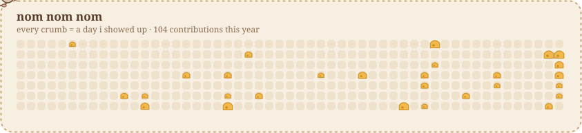

<table>
<tr>
<td valign="middle">

# hey, i'm Likhita ^.^

**A problem solver who loves turning complex challenges into simple, smart solutions.
I like to explore new technologies, and create things that make a difference.**

 

</td>
<td width="340" align="center" valign="middle">

</td>
</tr>
</table>

---

## `whoami`

---

## Tech Stack

<!--
  TO REMOVE a tech: delete its name from the i= list in the image link below (names are comma separated).
  TO ADD one: type its name into the same list. Handy names:
  python java c cpp js ts kotlin html css react nodejs express fastapi flask django
  mysql postgres sqlite mongodb tailwind bootstrap tensorflow pytorch sklearn
  git github docker vscode androidstudio figma linux aws firebase
-->

---

## Featured Projects

<table>
<tr>
<td width="50%" valign="top">

### [Sinus Segmentation & Gender Prediction](https://github.com/Likhi2810ta/sinus_segmentation_gender_predication)
*Medical imaging meets ML.*

Takes a sinus scan, segments the sinus region, and uses the segmented features to predict gender. Packaged as an `app.py` interface on top of a reusable `core` pipeline, so the model code stays separate from the UI.

**Stack:** Python · Image Segmentation · Deep Learning

</td>
<td width="50%" valign="top">

### [AIML Project Tracker](https://github.com/Likhi2810ta/MiniProjectTracker)
*Know where every project stands.*

A full-stack web app that runs the whole project lifecycle for the AIML department: batches, semesters, teams (with Excel bulk upload), guide and examiner assignment, and a three-review marks system with lockable reviews and Excel export.

**Stack:** Full-stack Web · Role-based access · Excel export

</td>
</tr>
<tr>
<td width="50%" valign="top">

### [Second Helping](https://github.com/Likhi2810ta/second-helping)
*Good food deserves a second plate.*

Connects people who have surplus food with people nearby who need it. A map view shows what is available around you, with sign-in, photo uploads and realtime updates. A FastAPI layer sits in front of Supabase and passes each user's own token through, so row-level security in Postgres decides who can see or change what.

**Stack:** React · TypeScript · Vite · Tailwind · Leaflet · FastAPI · Supabase (Postgres + PostGIS)

</td>
<td width="50%" valign="top">

### [GestureSense](https://github.com/Likhi2810ta/GestureSense)
*Control your laptop with a wave.*

A dual-hand gesture controller. Your left hand sets screen brightness and your right hand sets system volume, by pinching or spreading thumb and index finger in front of the webcam. Raise a pinky to lock a control. Tracks both hands in real time with live on-screen feedback.

**Stack:** Python · OpenCV · MediaPipe · NumPy · Pycaw

</td>
</tr>
<tr>
<td width="50%" valign="top">

### [Orbital Foundry](https://github.com/Likhi2810ta/Ai_Predictive_Maintainance)
*Predict machine failures before they happen.*

A self-evolving predictive maintenance platform for industrial machines. It flags anomalies in real time using Z-score analysis, Isolation Forest and trend scoring, with a FastAPI backend, a React dashboard, a Streamlit monitoring agent and a live simulation server. Deployed end to end.

**Stack:** Python · FastAPI · scikit-learn · React · Streamlit · Express

</td>
<td width="50%" valign="top">

### [JIT DVG Project](https://github.com/Likhi2810ta/JIT-DVG-PROJECT)
*A Gmail clone with a brain.*

A Gmail-style webmail app with JWT auth, a React + TypeScript frontend and a FastAPI backend, plus two small scikit-learn models: a spam classifier and a priority ranker for incoming mail.

**Stack:** React · TypeScript · FastAPI · SQLAlchemy · scikit-learn

</td>
</tr>
</table>

### And more

| Project | What it is | Stack |
|---|---|---|
| [FinTrack](https://github.com/Likhi2810ta/FinTrack) | Personal finance tracker with charts and JWT auth | React · Python |
| [StayScape](https://github.com/Likhi2810ta/StayScape) | Airbnb-style stays platform, [live](https://stayscape-vdtp.onrender.com) | Node · Express · MongoDB |
| [wellness-planner](https://github.com/Likhi2810ta/wellness-planner) | Wellness routines built around real-life constraints | Full-stack |
| [Focus_Caf-](https://github.com/Likhi2810ta/Focus_Caf-) | Focus app | Kotlin |
| [hack_malenadu](https://github.com/Likhi2810ta/hack_malenadu) | Hackathon project | Python |

---

## a mouse nibbling cheese on my contribution graph

  

  

---

